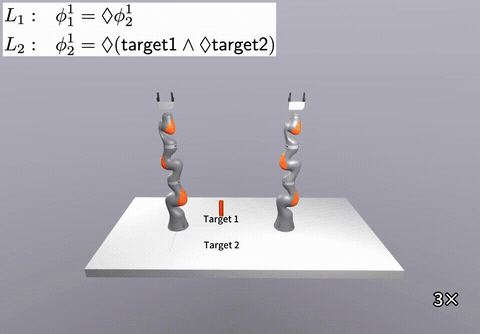
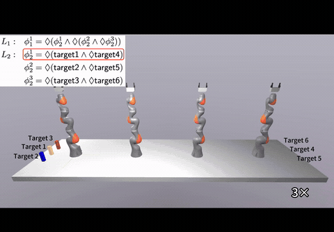
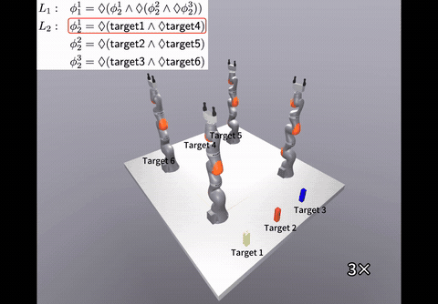
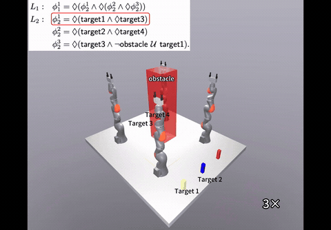
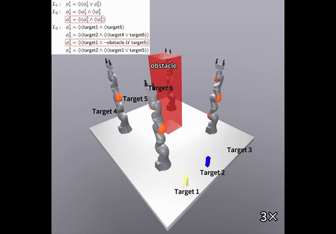
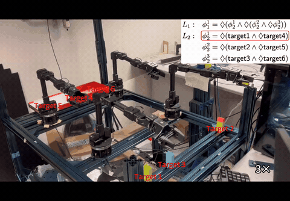
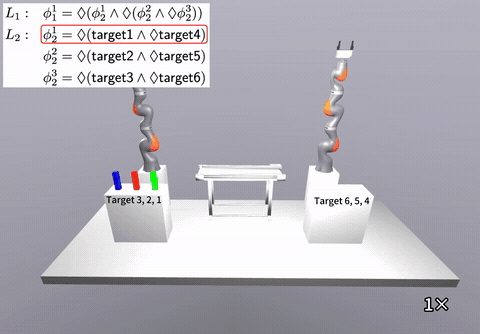
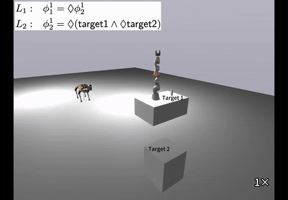
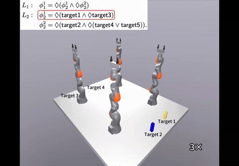
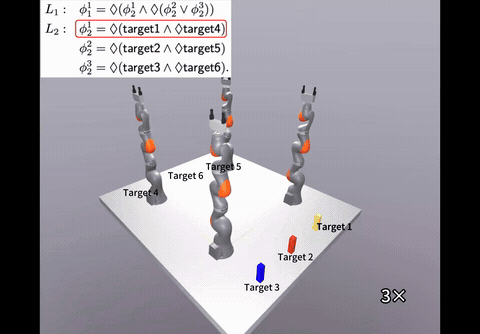

# Task_Motion_Planning_with_HLTL_and_GCS

A fast and scalable task and motion planning framework for tasks expressed in Hierarchical Linear Temporal Logic (H-LTL). 

This repository contains code to accompany the paper [*Hierarchical Temporal Logic Task and Motion Planning for Multi-Robot Systems*](https://arxiv.org/abs/2504.18899) by Zhongqi Wei, Xusheng Luo and Changliu Liu. 

## Acknowledge 

The codebased is based on the work [*Temporal Logic Motion Planning with Convex Optimization via Graphs of Convex Sets*](https://github.com/vincekurtz/ltl_gcs) by Vince Kurtz and Hai Lin.

## Installation

Make sure all dependencies are installed, then:

```
$ git clone https://github.com/intelligent-control-lab/Task_Motion_Planning_with_HLTL_and_GCS.git
$ cd Task_Motion_Planning_with_HLTL_and_GCS
$ pip install .
```

## Dependencies

- [Drake](https://drake.mit.edu/)
- [MONA](https://www.brics.dk/mona/download.html)
- [ltlf2dfa](https://github.com/whitemech/LTLf2DFA)
- [MOSEK](https://www.mosek.com/) (license only)

Of these, only MONA and MOSEK require special consideration: all others can be
installed with `pip`. For MOSEK, you only need a valid license: MOSEK itself is
installed along with Drake. 

## Examples


1. **Two-arm handover**

   `examples/2_two_robot_case2.py`

   [](media/task_videos/two_handover.mp4)

2. **Four-arm linear handover**

   `examples/3_four_iiwa_linear_case.py`

   [](media/task_videos/four_linear.mp4)

3. **Four-arm rectangular handover**

   `examples/4_four_iiwa_rectangular_case.py`

   [](media/task_videos/four_rectangle.mp4)

4. **Handover around an obstacle**

   `examples/4_four_iiwa_rectangular_complex_case1(obstacle).py`

   [](media/task_videos/four_obstacle.mp4)

5. **Hierarchical obstacle task**

   `examples/4_four_iiwa_rectangular_complex_case1(obstacle)1.py`

   [](media/task_videos/four_obstacle_hierarchy.mp4)

6. **WX200 hardware handover** — Paper video / hardware experiment

   `examples/5_four_wx200_rectangular_case.py`

   [](media/task_videos/four_wx200.mp4)

7. **Two arms with a conveyor**

   `examples/6_two_iiwa_conveyor_case.py`

   [](media/task_videos/conveyor.mp4)

8. **iiwa–Spot handover**

   `examples/7_iiwa_spot_handover_case.py`

   [](media/task_videos/spot_handover.mp4)

9. **Alternative destination**

   `examples/4_four_iiwa_rectangular_complex_case2.py`

   [](media/task_videos/four_alternative.mp4)

10. **Alternative task branch**

   `examples/4_four_iiwa_rectangular_complex_case3.py`

   [](media/task_videos/four_alternative3.mp4)

## Full paper video

[Watch the original video](https://www.youtube.com/watch?v=FPTLGm5iigc). Clip boundaries and source attribution are recorded in the [media manifest](media/task_videos/manifest.json).
